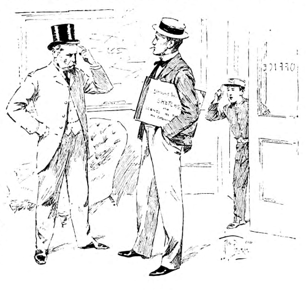

# All about Charles Eyre Pascoe (1842-1912)

This is the *Pascoe Portal*. It collects in one place all I have been able to discover about an obscure Victorian journalist and publisher of handbooks of various kinds. That's him on the left of the picture, in the top hat. The picture appears in a curious 1893 work entitled *London's world's fair for 1893 and Great Social, Political, and Moral Exposition. The Spirit of the Age at a glance* and was drawn by the other chap, a young artist named  [Fred Pegram](https://www.artbiogs.co.uk/1/artists/pegram-frederick).  Pascoe and Pegram are depicted trying to decide what copy they will deliver to the importunate messenger boy at right. 

I came across Pascoe by way of his directory of living actors and actresses, *The Dramatic Register* (1879), which provides much interesting background for the plays published in Lacy's Acting Edition. And then I fell down a rabbit hole. Here's some of what I found there...

1. A [bibliography](https://lb42.github.io/Pascoe/CEP-bib.html) of books, pamphlets, letters, etc. attributed to Pascoe.
1. A [biographical sketch](https://lb42.github.io/Pascoe/CEP-bio.pdf) of his life (a revised and improved version will appear here soon)
1. A [TEI conformant transcription](https://lb42.github.io/Pascoe/theDramaticList_1880.html) of the *Dramatic List* (2nd ed, 1880)
1. [Selected letters to the press](https://lb42.github.io/Pascoe/CEP-letters.html) on various topics
1. [Selected contemporary reviews](https://lb42.github.io/Pascoe/CEP-reviews.html) of his publications

1. [Newspaper reports](https://lb42.github.io/Pascoe/CEP-death.html) of his death as printed in the *Sutton and Cheam Advertiser* 15 Nov 1912, page 5,  and elsewhere.

These pages brought to you by CETEICEAN, operating on TEI XML sources downloadable from https://github.com/lb42/Pascoe
